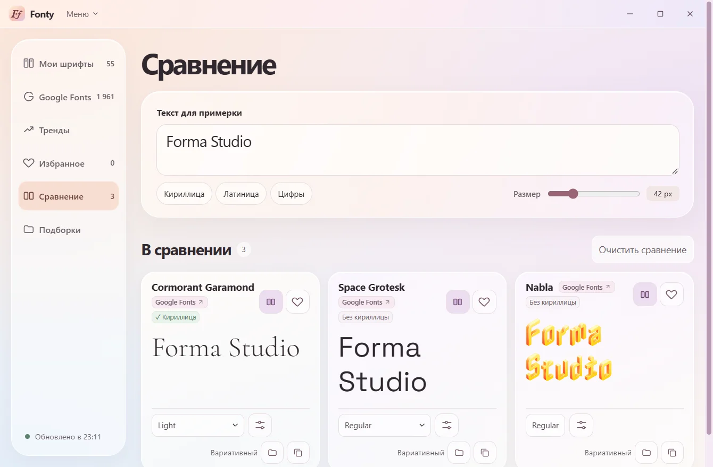
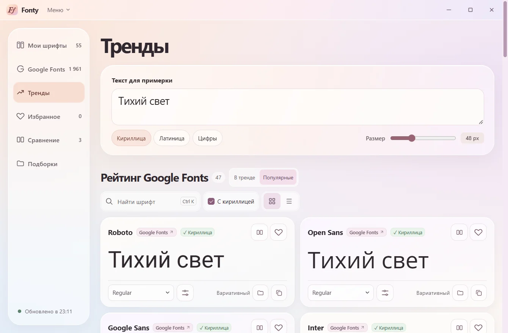

<p align="center"></p>
<h1 align="center">Fonty</h1>
<p align="center"><strong>Сравнивайте шрифты на своём тексте.</strong></p>
<p align="center">Локальная коллекция и Google Fonts в одном приложении для Windows.</p>
<p align="center"><a href="https://github.com/artem-korablev/fonty/raw/refs/heads/main/download/Fonty-1.4.2.exe"><strong>Скачать Fonty 1.4.2 для Windows</strong></a></p>



## Что можно делать

- **Примерять.** Введите фразу один раз. Она появится во всех карточках, а размер можно изменить одним ползунком.
- **Сравнивать.** Закрепите до четырёх семейств рядом. Меняйте начертания и вариативные оси у каждого шрифта отдельно.
- **Собирать подборки.** Сохраняйте шрифты, текст, размер и настройки начертаний для каждого проекта.
- **Переносить выбор в Figma.** Копируйте название семейства, начертание и значения вариативных осей.
- **Искать кириллицу.** Фильтруйте шрифты по её поддержке. Пунктир в образце выделяет символы, которых нет в выбранном начертании.

## Коллекция и Google Fonts

«Мои шрифты» показывает установленные семейства и исключает стандартный набор Windows. По умолчанию свежие файлы идут первыми. Во вкладках «Google Fonts» и «Тренды» можно просматривать каталог и рейтинги без установки шрифтов.



Настройки и подборки хранятся на компьютере. Для предпросмотра Google Fonts нужен интернет. Каталог и рейтинги зафиксированы на дату сборки.

## Запуск и сборка

Скачайте и запустите `Fonty-1.4.2.exe`. Сборка для Windows 10 и 11 x64 использует Microsoft Edge WebView2 Runtime. [Страница WebView2](https://developer.microsoft.com/microsoft-edge/webview2/)

Чтобы собрать приложение, запустите из папки исходников в PowerShell

```powershell
powershell -NoProfile -ExecutionPolicy Bypass -File .\build.ps1
```

Параметр политики выполнения действует только на запущенный процесс. Скрипт использует компилятор .NET Framework, скачивает WebView2 SDK версии 1.0.4370.26, проверяет контрольную сумму и создаёт `dist/Fonty.exe`.

Каталог и рейтинги получены из Google Fonts. Список системных шрифтов основан на списках Microsoft. Лицензия WebView2 доступна в меню «О Fonty». [Google Fonts](https://fonts.google.com/) · [Список Windows 11](https://learn.microsoft.com/typography/fonts/windows_11_font_list) · [Список Windows 10](https://learn.microsoft.com/typography/fonts/windows_10_font_list)
